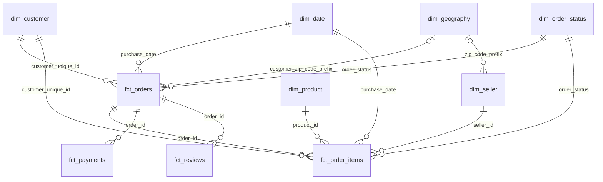

# Модель core

## Гранулярность и ключи

| Таблица | Строка | Первичный ключ | Строк снимка |
|---|---|---|---:|
| dim_date | календарный день 2016–2018 | date_key | 1 096 |
| dim_order_status | статус с бизнес-флагами | order_status | 8 |
| dim_geography | исходный почтовый префикс | zip_code_prefix | 15 080 |
| dim_customer | человек | customer_unique_id | 96 096 |
| dim_seller | продавец | seller_id | 3 095 |
| dim_product | карточка товара | product_id | 32 951 |
| fct_orders | заказ всех статусов | order_id | 99 441 |
| fct_order_items | единица товара продавца в заказе | order_id, order_item_id | 112 650 |
| fct_payments | исходная запись оплаты | order_id, payment_sequential | 103 886 |
| fct_reviews | исходная запись отзыва о заказе | order_id, review_id | 99 224 |

PK и FK объявлены в PostgreSQL. Приведение пустой строки: nullif(trim(x),''). Идентификаторы и почтовые префиксы хранятся как text; денежные величины — numeric(12,2). Raw не очищается и не изменяется сборкой.

## Связи

## Покупатель и география

dim_customer содержит одного человека. source_customer_id, исходный город, штат и почтовый префикс сохранены в fct_orders, поскольку один человек может иметь несколько адресных записей. У 250 покупателей несколько префиксов, у 39 — несколько штатов в источнике.

dim_geography выбирает самый частый город префикса, затем самый частый штат для выбранного города. Ничьи разрешаются детерминированно по COLLATE C. city_variant_count и state_variant_count показывают неоднозначность. 33 префикса встречаются в нескольких штатах. Каноническая подпись не заменяет исходный адрес заказа или продавца. data/extra/ не используется.

## Две фазы сборки заказов

20_fct_orders.sql создаёт заказы и атрибуты, необходимые FK дочерних фактов. После загрузки позиций, платежей и отзывов 24_order_rollups.sql отдельно агрегирует каждый факт до order_id и обновляет fct_orders. Все фазы находятся в одной транзакции; промежуточное состояние не публикуется.

Канонический источник стоимости товаров и доставки — fct_order_items. Платёжные суммы — отдельные фактические значения fct_payments. Между независимыми деталями не выполняется JOIN. Каждый источник свёртки содержит ровно одну строку на заказ. Деньги без исходных записей остаются NULL, счётчики равны 0, has_items/has_payments/has_reviews фиксируют наличие записей.

review_score_avg — среднее всех исходных отзывов заказа; review_count сохраняется для корректного взвешивания. Детальные отзывы не удаляются. Чтобы получить среднее по отзывам, нужны веса review_count; среднее по заказам считается без этих весов.

## Даты, статусы, каталог

purchase_at и даты этапов — timestamp без придуманного часового пояса. delivery_days — фактически прошедшие сутки, estimate_days и delay_days — разницы календарных дней. is_late неизвестен без обеих дат. has_chronology_anomaly помечает противоречия, даты не переставляются.

is_revenue определяется только dim_order_status. is_terminal включает завершённые, отменённые и недоступные заказы. is_canceled относится только к canceled. is_shipped_out описывает статусы shipped и delivered; наличие фактической даты этапа хранится независимо. Денормализованный is_revenue в позициях проверяется относительно справочника. Изменение статусных правил требует пересборки.

Категория хранится в dim_product по исходному коду. '__unknown__' — явное значение для пустой категории. Отсутствие английского перевода сохраняется как NULL; display использует исходный код. Объём — см³, NULL при отсутствии любого габарита. Исходные опечатки lenght исправлены только в core.

mart.order_metrics — представление уровня заказа, читающее только core. Финальные ответы читают непосредственно core. Сборка не создаёт таблиц под конкретные вопросы.
