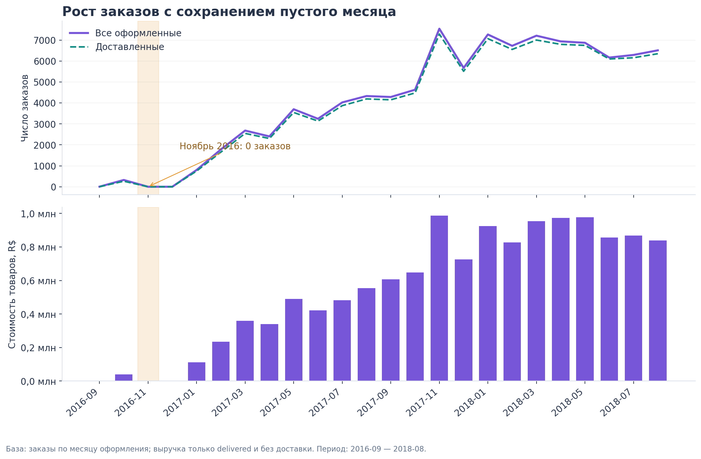
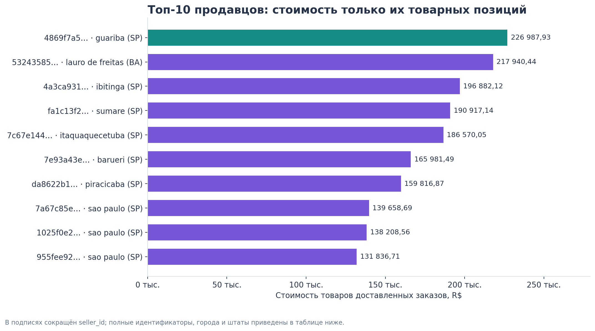
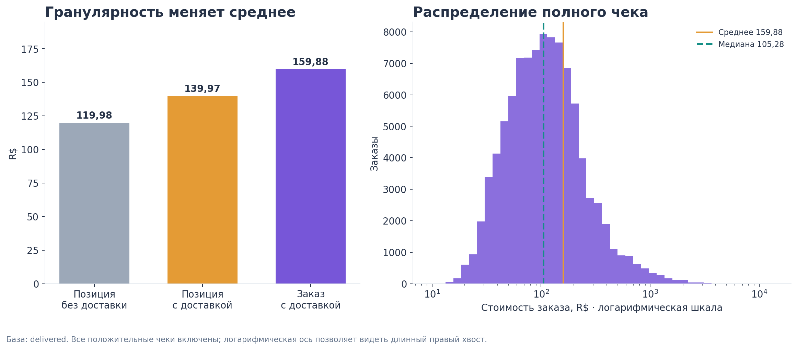
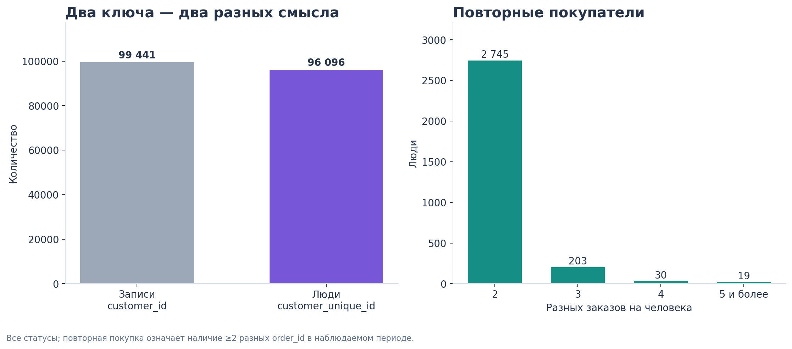
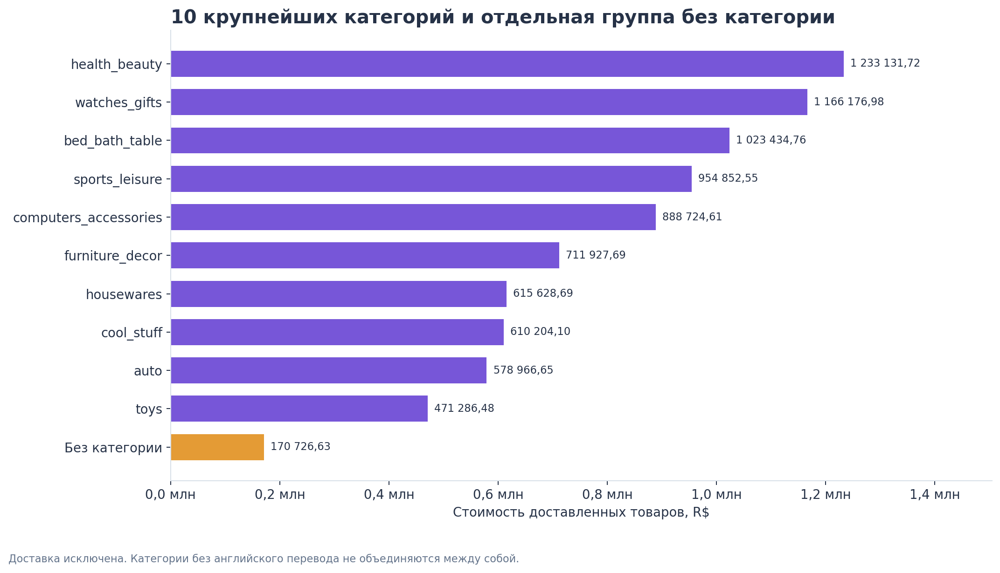
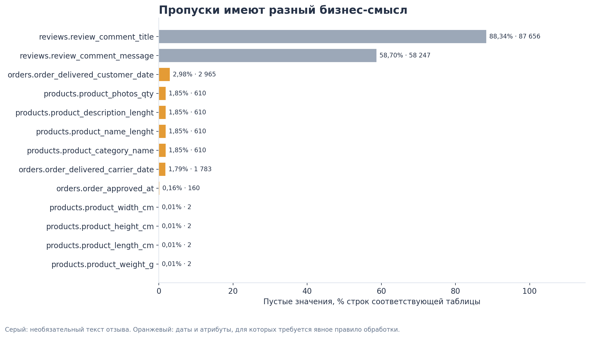
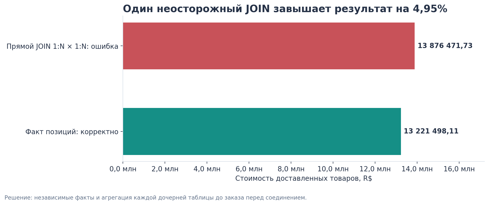
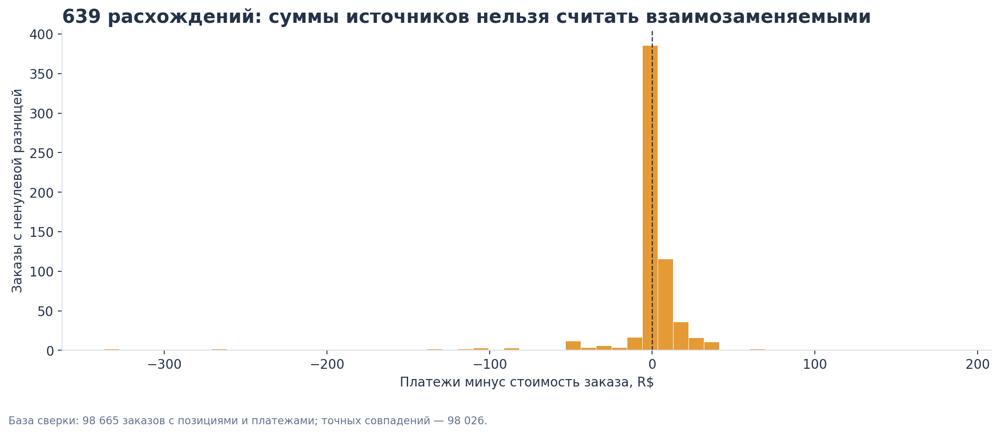
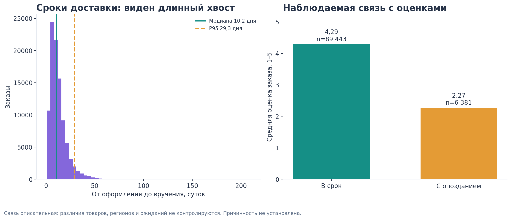

# EDA: выводы для архитектуры

Исследование выполнено на восьми оригинальных CSV. Это сверка исходников, не окончательные SQL-ответы из core.

## Пять вопросов

- Q1: 24 месяца; пустой 2016-11; выручка 13221498.11.
- Q2: первый продавец 4869f7a5dfa277a7dca6462dcf3b52b2; выручка 226987.93.
- Q3: средний чек 159.88; среднее число строк и единиц 1.142198.
- Q4: 96096 покупателей; 2997 повторных; 3.1188%.
- Q5: 74 категории; крупнейшая beleza_saude, 1233131.72; итог 13221498.11.

## Проблемы и обработка

| Область | Находка | Количество | Правило |
|---|---|---:|---|
| Ключи | review_id не уникален | 814 | Ключ отзыва — (order_id, review_id); сохранить все исходные отзывы |
| Связи | Заказы с несколькими продавцами | 1278 | Выручку продавца считать по его позициям |
| Связи | Заказы с несколькими платежами | 2961 | Агрегировать платежи до заказа перед JOIN |
| Связи | Заказы с несколькими отзывами | 547 | Явно определить правило среднего рейтинга заказа |
| Полнота | Заказы без позиций | 775 | Сохранить заказы; отсутствие стоимости не подменять фактом нулевой стоимости |
| Полнота | Доставленный заказ без платежа | 1 | Сумму платежей оставить неизвестной; сформировать предупреждение |
| Каталог | Товары без категории | 610 | Отдельная категория «Без категории» |
| Каталог | Товары с категорией без перевода | 13 | Сохранить исходную категорию, использовать PT как подпись |
| Деньги | Расхождения суммы заказа и платежей | 639 | Хранить обе суммы и разницу; не исправлять источник автоматически |
| Даты | Передача перевозчику раньше покупки | 166 | Флаг качества хронологии; не переставлять даты |
| Даты | Вручение раньше передачи перевозчику | 23 | Предупреждение и ограничения расчёта этапов доставки |
| Даты | delivered без даты вручения | 8 | Исключать из знаменателя сроков и просрочки, сохраняя сам заказ |

## Дополнительные инсайты

- Прямой JOIN завышает стоимость доставленных товаров на 4.9539%.
- Медиана чека 105.28 R$ отличается от среднего 159.88 R$.
- Топ-10 продавцов дают 13.27% стоимости доставленных товаров.
- Опоздания: 6534 / 96470 = 6.77%.
- Средняя оценка заказа: в срок 4.29, с опозданием 2.27; причинность не установлена.

## Графики

### 01_monthly_orders_revenue

### 02_top_sellers

### 03_average_order_value

### 04_customers_repeat_orders

### 05_categories_revenue

### 06_missing_values

### 07_join_fanout

### 08_payment_reconciliation

### 09_delivery_reviews

